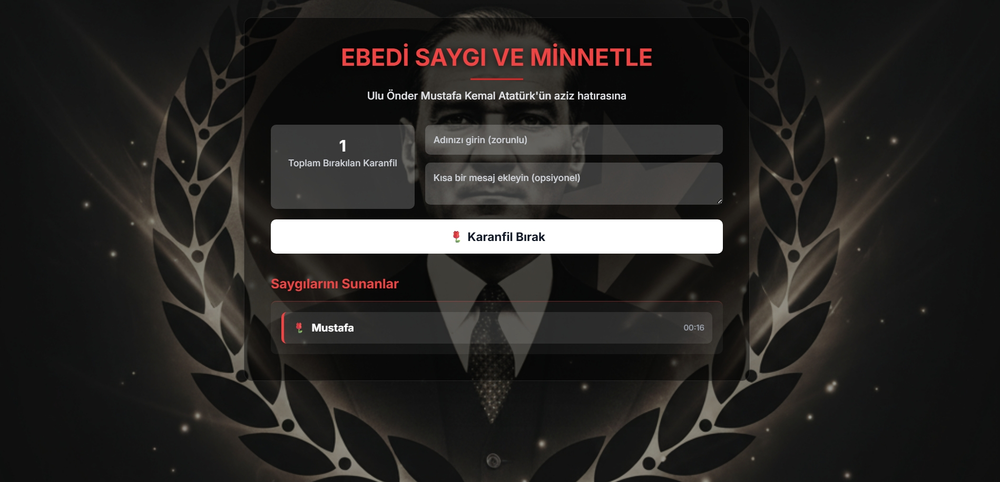

# 🕊️ Atatürk Anma Sayfası

Ulu Önder Mustafa Kemal Atatürk’e saygı ve minnetimizi dijital ortamda sunmak için hazırlanmış interaktif bir web sayfası.  
Ziyaretçiler, anıta **karanfil bırakabilir**, **isimlerini** ve **mesajlarını** ekleyebilirler.

---

## 🌐 Canlı Site
🔗 https://plutoowner.github.io/Ataturk-Anma/

---

## 🖼️ Önizleme

---

## ⚙️ Özellikler
- 🕯️ Ziyaretçi ismi ve mesaj ekleme  
- 🌹 Karanfil bırakma sayacı  
- 🖤 Blur ve loş arka plan tasarımı  
- 💻 Mobil ve masaüstü uyumlu arayüz  

---

## 🚀 Kullanılan Teknolojiler
- **HTML5**, **CSS3**, **JavaScript**
- **Firebase** (veritabanı & barındırma)
- **Responsive tasarım**

---

## 🤝 Katkıda Bulunmak
1. Repoyu forkla  
2. Yeni bir branch oluştur (`feature/yeni-ozellik`)  
3. Değişikliklerini yap  
4. Pull request gönder  

---

## 📜 Lisans
Bu proje, Atatürk’ün hatırasına saygı amacıyla açık kaynak olarak paylaşılmıştır.  
Ticari amaçla kullanımı yasaktır.

---

> “Benim naçiz vücudum elbet bir gün toprak olacaktır; fakat Türkiye Cumhuriyeti ilelebet payidar kalacaktır.”  
> — **Mustafa Kemal Atatürk**
